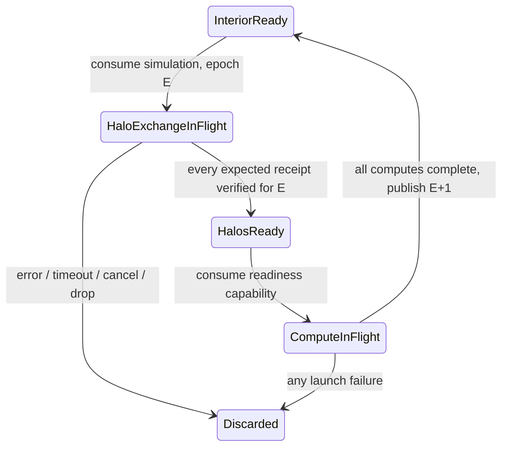

# Chat 10: checked local slab halo protocol

## Prerequisites and scope

Progression update (2026-10-12): the owner authorized proceeding to Chat 11
documentation/community work without waiting for two-GPU hardware. Hardware
validation is a deferred community follow-up rather than a development-stage
gate. Native acceptance and GPU performance evidence remain pending; this does
not alter the protocol's safety checks. See the
[handoff disposition](handoffs/10-multi-gpu-halo.md#development-progression-disposition--2026-10-12).

Checked on 2026-10-03 before implementation: Chat 08's returned 24-command GPU
evidence establishes single-GPU acceptance on the supplied Arch experimental
configuration. Its September 27 review reports no confirmed security vulnerability;
SECURITY.md reports no confirmed high/critical finding. The default-spin timing
follow-up remains open and is not a high/critical security finding. These are
recorded prerequisites, not fresh local GPU execution or release approval.

An elevated read-only Win32_VideoController query on this Windows host returned
only Intel UHD Graphics 620. Neither `nvidia-smi` nor `nvcc` was found on PATH.
No CUDA multi-GPU run is available here. The permitted hardware-independent
prototype is `prototypes/halo`, isolated from the existing working-tree changes.
All device/context/stream/buffer identities in it are logical identities.

## Partition and protocol

For N cells and D devices, device i receives floor(N/D) + (i < N%D) cells.
Require 2 <= D <= N, D <= 64, N <= 1,000,000. Adjacent slabs exchange their
first/last **input-generation** cells. Global exterior ghosts are fixed zero.
The stencil is output[i] = .25*left + .5*center + .25*right; this is a 1D
protocol model, not the existing 2D Poisson solver. A one-cell slab depends on
both ghosts and has no independent interior. Empty slabs are rejected.

The public ownership transitions are `Simulation -> Exchange -> HalosReady ->
Simulation`. Per-slab private checked states represent InteriorReady,
Exchange(E), HalosReady(E), Compute(E). Compute is synchronous in this model,
so ComputeInFlight is not a public asynchronous CUDA future. Compile-fail
controls reject calling boundary compute on Exchange and observing the consumed
input Simulation. Constructors, completion records and slab storage are private.

A completion is compared to an independently created expected descriptor:
simulation identity, epoch, input and source buffer generation, source and
destination slabs/devices/contexts/buffer slots, destination direction, source
stream, destination copy/compute streams and event slot. Only an owned pending
ticket can complete; duplicates fail. Readiness revalidates installed descriptors.
The event slot may be reused in a later timestep, but its old descriptor fails.
This is stronger than renaming an event; the event alone grants no authority.
This model copies immutable source values when creating tickets; a native adapter
must preserve the same source-allocation lifetime until transfer completion.

Exchange owns the entire simulation. Interior work writes private output while
copies target separate ghost slots. Boundary work becomes callable only after
all required receipts pass. All boundary launches complete before any generation
swap. Copy failure, malformed identity, launch failure, cancellation and timeout
discard the entire batch; no partially updated values can be observed or resumed.
CPU drop immediately frees private vectors because no native work is outstanding.

## Transport and native CUDA adapter contract

Follow-up on 2026-10-03: `prototypes/halo-native` now contains a standalone CUDA
worker implementing this contract with actual runtime calls and kernels. Its
coordinator is tested locally against a queued host backend. Native CUDA build,
two-GPU correctness, sanitizers and measured overlap remain unverified. The
worker has no Rust FFI or cuTile integration; the Rust model above stays separate.
Use [the native worker runbook](../prototypes/halo-native/README.md) for the
supervised Linux hardware checks. The following requirements describe the native
contract and the proof still needed on hardware.

Discover devices and stable UUIDs using the CUDA driver, verify local context
ownership and distinct streams, and probe directed peer capability for each
neighbor pair. Do not infer P2P capability from GPU count. Enable peer access
only for those owned contexts; reject other errors explicitly. Native receipts
must hold actual allocation/context/stream/event owners plus the logical binding.
An event recorded on a destination copy stream after that copy must be queried
in its correct context before readiness is granted. Read input readiness on the
source stream first. Use destination compute-stream waits for local copy events;
do not assume an event on the source proves destination visibility. If native
semantics or cross-context ordering cannot be proven, synchronize explicitly.

The modeled all-or-nothing transport choice is Peer or HostStaged. In a native
adapter, an unavailable peer link must select pinned-host staging (source device
to bounded pinned host buffer, confirmed completion, then host to destination,
confirmed completion), or return a clear UnsupportedPeer error if staging is
disabled. Do not retry a failed P2P copy within a potentially poisoned context.
Host staging must retain host and device owners through both legs; actual
overlap depends on hardware and pinned-memory transfer semantics. Mixed directed
link capabilities and actual peer enablement are not implemented by this model.

On native cancellation/drop, retain every involved allocation/event/context until
all submitted streams have proven completion. Failed drain, unknown completion,
or sticky device error requires quarantine plus disposal of the isolated worker,
following Gudra's existing fail-stop policy. A deadline bounds host waiting; it
cannot cancel an in-flight DMA or prove deallocation safe. The model's deadline
is scheduler ticks and requires calls to `progress`; it is not a wall-clock
watchdog. The native adapter must use a supervisor watchdog and bound retries.

The Rust model adds no raw handle API, IPC export, transport decoder, CUDA call
or unsafe code. The standalone native worker adds private CUDA calls and kernel
launches; it accepts bounded CLI configuration and exports no native handles.
Native handles must stay private; do not accept process/transport peer
dimensions or offsets as authority. Derive offsets from a locally validated
partition, validate extent/byte arithmetic and peer identity, cap staging and
outstanding events, and verify direction independently. An IPC/multi-process
extension needs a separate authenticated protocol and security review.

## Timeline and performance accounting

`prototypes/halo/examples/timeline.rs` emits repeatable intervals for reference
and overlapped scheduling with both transports. The retained CSV lives in
`docs/evidence/chat10/timeline.csv`. Transfer intervals include the modeled legs,
and generation completion includes the synchronization gate, interior work and
boundary work. Reference mode starts interior at the last-copy tick, and boundary
starts after interior completion. Overlap mode starts interior at tick zero.

This demonstrates intended protocol scheduling only. It assigns one tick to
compute and seeded ticks to copy; it measures neither actual concurrency nor
speedup. There is no GPU performance claim. Before making one, profile at least
two physical GPUs with Nsight/CUDA events: include peer enablement and allocation
separately, warmup/JIT separately, all communication legs, stream waits, halo
validation, boundary kernels, generation commit and end-to-end makespan. Compare
equal work with overlap disabled, include fallback and readback costs, and state
whether setup and readback are amortized. Re-run security review before release.
