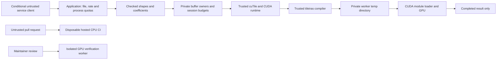

# Gudra threat model

## 2026-09-25 remediation status

The supported trust boundary is Gudra's public GPU facade. It keeps backend
objects private, validates session identity and resource limits, and retains or
quarantines owners until completion is proven. When a submitted operation
cannot be drained after an error or unwind, the enforced contract is process
fail-stop so the address space cannot free or reuse memory that the GPU may
still access. Direct use of separately declared `cutile` or `cuda-async`
dependencies expands the boundary and is outside Gudra's support contract.

The final candidate passed hosted CPU/security, separate-UID JIT helper tests,
and all 24 pinned GPU commands on an authorized disposable worker. The device
fault produced CUDA 719 and the child worker followed the required fail-stop
path; repeated execution and Compute Sanitizer memcheck/initcheck also passed.
SEC-001, SEC-004, and final GPU validation are closed. Repository administration,
account protections and final-revision provenance are verified. Under the
owner-authorized solo-maintainer governance policy, the technical release gate
is **PASS** for the bound candidate. This does not expand the deployment boundary
or authorize publication.

## Chat 07 candidate update — 2026-09-22

This update supersedes older statements above about the unchanged registry compiler
and absence of a project license. Release remains **FAIL**. SEC-001 has a local
Apache-2.0 compiler override: both run_tileiras and version probing use private
0700 directories under root-owned /tmp, exclusive bytecode creation, regular-file
output checks and cleanup on return/unwind. Root, compiler and same-UID processes
remain trusted. SIGKILL/abort can leave private directories; operator cleanup is
required only after child exit. No process-global environment mutation was added.
Linux helper unit/separate-UID tests passed in hosted CI at 401b665. Actual compiler integration and real GPU execution are pending;
this is implemented mitigation, not verified closure.

SEC-004 remains unresolved. Independent review traced synchronous sync_on dropping
results on failed synchronization, execute error/unwind before a result is retained,
and borrowed async result leaks that fail to retain outer allocations/session.
No partial outer-owner guard was represented as a solution. No destructive device
fault was injected. No critical/high exploit was established by this review.

Current CPU debug/release, UI, docs, formatting, Clippy, installer tamper controls,
locked dependency inventory, advisory/license/source/bans and secret checks passed
locally. GPU build exits 101 before facade/compiler verification due to missing
CUDA. Hosted CPU/security CI, Linux launcher tests, verified installer and separate-UID helper tests passed at public candidate 401b665 (run 35736906616). Repository protections, private-reporting functionality and signed provenance remain unverified. MIT was chosen under explicit
owner authorization. See the private Chat 07 handoff for candidate identities,
publication separation, exact remaining commands and acceptance criteria.

## Historical review record

The following records prior observations. Current changes and limitations are above.

Reviewed 2026-09-19. Baseline: `22f7ff1`; this document includes the local Chat 06 remediation. The user supplied seven actor scenarios and required numerical integrity/isolation to be assessed only across realistic boundaries.

## Overview

Gudra implements one weighted five-point Jacobi update. The default build has checked geometry, coefficients and a CPU oracle. Optional cuTile 0.3.1 support uploads private device allocations, creates fixed directional views, executes a 16x16 tiled kernel and reads back a consumed field. There is no network server, file parser, tenant scheduler, arbitrary PTX import, P2P API or release publisher.

| Component | Entry/consumer and evidence |
|---|---|
| Input geometry and CPU operation | `src/shape.rs:32`, `src/params.rs:20`, `src/reference.rs:34` |
| Private GPU owners/session | `src/gpu/mod.rs:33`, `src/gpu/cutile_impl.rs:21` |
| Upload/allocation and logical budgets | `src/gpu/cutile_impl.rs:92`, `src/limits.rs:18` |
| Fixed device kernel | `src/gpu/kernels.rs:8`; no caller-supplied source |
| Completion/readback | `src/completion.rs:18`, `src/gpu/cutile_impl.rs:304` |
| Development/release authority | `Cargo.toml:6`, `.github/workflows/rust.yml`; publication disabled |

| Deployment/workflow | Resource/capability | Configuration and effective location | Readers/writers; control |
|---|---|---|---|
| GPU API | Device allocations/stream | Caller ordinal; one private stream retained by Arc session | Private non-cloneable owners; Arc identity rejects cross-session buffers, even on same ordinal |
| GPU default budgets | Logical live bytes, buffers, operations | 256 MiB/buffer, 1 GiB/session, 64 buffers, 8 admitted operations | Mutex-serialized reservations; guards retained by buffers and owned futures; not physical VRAM or process quotas |
| JIT compiler | Host subprocess execution | CUTILE_TILEIRAS_PATH; else first nonempty CUDA_TOOLKIT_PATH/CUDA_HOME; discovered toolkit; PATH fallback | Trusted environment/install/loader required. Documented export selects /usr/local/cuda-13.3/bin/tileiras |
| Direct library JIT | Transient bytecode/cubin | OS temp directory/`<uuid>.bc`, same base `.cubin` | UUID and cleanup only; no private directory in dependency. SEC-001 |
| Private GPU launcher | Transient bytecode/cubin | Atomically created private `gudra-jit-*` directory; TMPDIR/TMP/TEMP set in child environment before startup | Linux owner/mode 0700; ancestor owner/write/sticky checks; trusted command, separate identity from hostile jobs |
| Default Gudra persistent cache | None | cuTile process-global store defaults to None; Gudra does not enable it | No disk-cache read on normal path. `/.cutile-cache/` ignore pattern is not the runtime location |
| Conditional Unix cache opt-in | Executable cubin store | XDG_CACHE_HOME/cutile/kernels or HOME/.cache/cutile/kernels; `<key[0..2]>/<key>.cubin` | Default root private-mode validation; custom store caller-owned. Checksums detect corruption, not malicious writers |
| Conditional Windows cache opt-in | Executable cubin store | LOCALAPPDATA/cutile/kernels with same shard layout | Inherited ACLs; a per-user pathname is not proof of exclusive access. Windows GPU execution is not certified |
| CPU CI | Source/build execution | Hosted Ubuntu 24.04; pinned checkout; read-only token; credentials not persisted | No privileged GPU runner, release credentials, imported executable artifacts or artifact uploads |
| GPU verification | Current Cargo-generated executable paths | `scripts/check-gpu-sanitizers.py`, entered by private-temp `verify-gpu.sh` | Reviewed source/dependencies only. Exact artifact selection prevents stale glob reuse; does not sandbox hostile code |
| Diagnostics/evidence | Paths, GPU topology, compiler stderr and grids | Backend Error text; local test output; target/ui metadata diagnostics | Operator-only logs. Sanitize before sharing. No automatic network logging |

Dependency evidence uses the locked crates' paths, not guessed repository files: `cutile-compiler-0.3.1/src/cuda_tile_runtime_utils.rs:148-177,200-210,867-938`; `src/jit_cache.rs:18-24,49-58,133-134,228-264,511-620`; `cutile-0.3.1/src/tile_kernel.rs:805-846`.

## Threat model, trust boundaries and assumptions

Assets are host/device grids, result integrity, GPU/host availability, allocation lifetimes, context identity, executable artifacts, build/CI authority, future release credentials and private diagnostic data.

| Actor | Starting control and boundary |
|---|---|
| 1. Benign local scientist | Shapes, coefficients, vectors and normal API ordering. Errors affecting only their own result are generally correctness issues |
| 2. Untrusted service client | Decoded dimensions/data and request rate when an application exposes these; no assumed environment, filesystem, compiler or credential control |
| 3. GPU co-tenant | Own processes/files and resource consumption; no assumed victim CUDA context access. A shared service account/temp directory is a separate conditional boundary |
| 4. Compromised dependency | Selected build scripts/proc macros/native tools execute as build/runtime user. Rust unsafe lint does not sandbox them |
| 5. Malicious contributor/PR | Proposed source, workflow and manifest changes executed on disposable hosted CI. No established right to protected main, secrets, releases or sensitive GPU hosts |
| 6. Artifact tamperer | Can replace bytes only where a real write boundary permits it. Persistent cache requires explicit enablement; transient compiler files exist by default |
| 7. Future peer/remote participant | Hypothetical messages/peer-memory claims; no current exposed entry point. Cannot be assumed to already control the local process |

The safe facade enforces lengths, positive representable dimensions, checked byte arithmetic, bounded tile grid, compact strides, immutable source roles, exclusive output borrows and session identity. Views/offsets are fixed internally; callers cannot create malformed strides or alternate mutable views. Partial-tile masking, alignment, address spaces, launch generation and final storage reclamation remain dependency/driver obligations.

Blocking calls retain borrows through synchronization. Owned lazy futures retain all owners and session, including before first poll. Normal cancellation drains; it does not cancel GPU execution. Completion invalidation prevents a failed borrowed output being treated as ready. Failed drains quarantine owners and enforce process fail-stop before destruction; the CUDA 719 disposable-worker test verifies this contract. Forgetting owners/futures leaks storage and keeps budget reservations charged.

No actual production service, GPU tenant architecture or remote peer was supplied. These deployment cases are conditional, not invented exposure. Recorded GPU results concern earlier commit `073f7c6`, reported Arch/CUDA 13.4 hardware; they are user-supplied evidence, not this audit's GPU execution or proof of the final changed revision. Public README/API/setup status text was reconciled accordingly.

## Attack surface, mitigations and attacker stories

| Priority | Scenario/capability gain | Prerequisites and impact | Controls and disposition |
|---|---|---|---|
| Closed, SEC-001 | Local co-user observes transient .bc name and interferes with derived .cubin path before compiler/readback | Discoverable shared temp could permit substitution | Vendored private per-compilation storage, ancestor checks, exclusive creation, cleanup, separate-UID tests and final JIT lifecycle pass |
| Conditional service concern, SEC-002 | Client requests valid 32768x32768 field (4 GiB) or accumulates jobs | Application maps input to GPU API without its own quotas; affects service availability | New session budgets reject before backend allocation/submission; static shape budget checks precede host allocation. OS/process/input quotas still mandatory |
| High-impact trust boundary; no exploit established | Malicious build script/proc macro/native tool runs as developer/CI user | Malicious dependency selection or compromised source/tool installation | Locked checksummed registry graph; exact cuTile; executable-capability inventory; advisory/license policy; unprivileged disposable builds; review dependency updates |
| Hardening, SEC-003 | Mutable action or overprivileged CI code compromises delivery authority | Original workflow inherited permissions and mutable checkout tag; no secret exposure established | Pinned SHA, explicit read-only permissions, no persisted credentials, locked builds and security checks. External protection settings remain unverified |
| Conditional cache risk | Co-user writes a store explicitly enabled by application | Cache write authority and opt-in required; checksums forgeable by writer | Persistence off by default; trust store permissions/custom backend; soft 2 GiB eviction is not disk quota |
| Closed proof gap, SEC-004 | Device fault fails drain while work might remain | CUDA fault with live execution | Owners are retained/quarantined and an undrainable worker aborts before release; deterministic seams and disposable CUDA 719 test pass. Poisoned-context recovery is outside the contract |
| Correctness, no vulnerability | Stale halo, unstable omega, NaN/infinity, intentional in-place CUDA fixture | Usually self-only result impact | Explicit numerical contract, independent oracle and negative-control labeling; no convergence or safety-critical certification claim |
| Future design only | Peer imports invalid/replayed memory descriptor or completion claim | No current API | Require peer identity/authentication, authorization, size/offset/stride validation, context binding, leases/revocation, ownership/fences, transport integrity/replay controls and quota design before implementation |

JIT abuse assessment: tensor extents are absent from the pinned cache key; stride/alignment divisibility has only 1/2/4/8/16 bins; float parameters do not specialize per value; grid is not constant-specialized here. Thus one-new-cubin-per-shape/value is contradicted by source (`tile_kernel.rs:87-90`, `specialization.rs:42-66`, `kernel_launcher_generator.rs:919-945`). The underlying L1 infrastructure is unbounded, but this facade does not expose arbitrary kernels/types/compile options. Compiler memory/time and repeated failures still require worker quotas. No automatic library retries occur; rejected persistent entries have one rebuild fallback.

## Severity calibration

Critical requires a clear severe boundary compromise, such as unauthenticated release-signing authority. No such path was found. High could apply to demonstrated malicious code execution in a privileged build or cross-tenant context, or silent result corruption in a realistic high-impact service; unsafe syntax or a local crash alone is insufficient.

SEC-001 is medium because the missing private transient-file boundary is source-established, but executable substitution requires local access, a race and compiler/OS prerequisites. Driver host-code execution was not demonstrated. Same-user hostile code already has equivalent process authority and is not a new privilege gain.

Low covers constrained low-impact exposure with an actual victim. Informational records cover absent release controls, unproved behavior and improvements without an established exploit. Confidence in source facts is separate from confidence in a deployment or exploit. No critical/high finding was validated.
