# Timestep runtime

`Gpu::double_grid(shape, initial_halo, rhs)` constructs a ready `DoubleGrid`.
It privately owns two independent haloed device allocations, an immutable RHS,
and their session. Initial boundaries are fixed Dirichlet data; all boundary
cells, including unused corners, are copied unchanged on each update. There is
no in-place Jacobi update, implicit periodic boundary, or evolving halo policy.

```rust,no_run
use gudra::{gpu::Gpu, JacobiParams, Shape2D};
async fn run() -> gudra::Result<()> {
    let gpu = Gpu::new(0)?;
    let shape = Shape2D::new(17, 19)?;
    let p = JacobiParams::new(0.5, 0.01)?;
    let mut grid = gpu.double_grid(shape,
        vec![1.0; shape.haloed_len()], vec![0.0; shape.interior_len()])?;
    for _ in 0..5 {
        grid = grid.advance_async(25, p)?.await?;
        let (ready, snapshot) = grid.observe()?;
        // Snapshot is an independent host Vec, including the one-cell halo.
        println!("completed {} steps", ready.completed_steps());
        drop(snapshot);
        grid = ready;
    }
    Ok(())
}
```

`advance` is the equivalent consuming, blocking path. Neither path allocates
device storage or transfers a grid between steps. `advance_async` is lazy: method
return means admitted, not submitted. First poll may JIT-compile. A batch has one
admission reservation but submits and awaits each timestep separately. It does
not promise whole-batch enqueue, executor fairness, or overlap within one grid.
Use finite batches to bound host polling work and allow observation/cancellation.

```mermaid
stateDiagram-v2
    [*] --> Ready: allocate A, B, RHS
    Ready --> Admitted: advance_async consumes all owners
    Admitted --> InFlight: first poll borrows A and RHS; mutably borrows B
    InFlight --> Swap: completion proven
    Swap --> InFlight: swap A/B; next timestep
    Swap --> Ready: final completion returns owners
    Admitted --> Released: drop before poll
    InFlight --> Draining: drop or execution error
    Draining --> Released: stream completion proven; discard entire state
    Draining --> Aborted: completion cannot be proven
    Ready --> Observing: observe consumes owner
    Observing --> Ready: completed readback returns owner plus host snapshot
    Observing --> Released: recoverable readback error
    Observing --> Aborted: completion cannot be proven
    Ready --> Released: drop or admission/count error
```



During a queued operation the Rust future owns all allocations. Its child
`DeviceFuture` holds borrows and backend retention guards until completion or
successful cancellation drain. Dropping pending work can block on the whole
private session stream, including unrelated work on that session. Cancellation
discards state; it does not stop a running kernel or restore the previous step.
`mem::forget` leaks the owner/reservation rather than freeing in-flight memory.
The existing backend aborts on failed drain or uncertain execution unwind.

| Property | Enforcement |
|---|---|
| No access/reuse while in flight | Move of `DoubleGrid` into future; private fields; no Clone or raw handles |
| No in-place stencil | Separate allocations; immutable current and exclusive next kernel arguments |
| Valid next-step state | Swap only after successful completion; no partially completed owner returns |
| Shape/session consistency | Checked constructor, private immutable metadata, backend launch validation |
| Scalar launch bounds | Constructor limits each haloed axis to 65,535 blocks (interior <=65,533) |
| Resource limits | Reserve both grids and RHS before host duplication; one operation reservation per batch |
| Counter validity | Checked addition before execution |
| Data accuracy/convergence | Numerical tests/application policy; not a type guarantee |
| Observation ordering | Consumes ready state; readback synchronizes before returning independent host data |
| Unknown device completion | Process abort, not a usable or recoverable grid |

Recoverable errors return `Error` and consume all grid owners. They deliberately
do not include a `DoubleGrid` payload. This is the defined unusable state; no
public Poisoned type can recover it. Older borrowed single-step APIs retain their
existing `InvalidBuffer` behavior. Driver/context recovery is unsupported.

Another stream cannot obtain these allocations through the safe facade: no
pointers, tensors, streams, aliases, or backend import constructors are exported.
Distinct `Gpu` sessions can operate concurrently on their own allocations. Calls
sharing a session use its ordered stream. Unsafe external code or independent
backend access is outside this guarantee.

`Gpu` and ready buffer owners, including `DoubleGrid`, inherit `Send + Sync`
from private backend owners and synchronized admission state. Compile controls
assert this. Shared `&DoubleGrid` exposes only shape/count; all data operations
consume ownership. No custom unsafe auto-trait implementation is added. The
returned future promises `Send`, not `Sync` or `Unpin`; pin it and poll exclusively.
Each new submission binds its device; the existing child future/drop handles
thread migration during completion and draining. Dropping `Gpu` before a future
completes is supported because buffers retain the session.

Graphs are not exposed. [ADR 008c](adr/008c-graphs.md) records the decision and
required ownership, shape, address, and parity constraints for future replay.

## Verification and performance

The GPU test lane exercises 125 steps on tiny, narrow, rectangular and partial
16x16-size domains, alternating blocking/async batches of 25. Every sampled
haloed result is compared with repeated independent CPU `jacobi_into` updates.
Finite values require `abs(actual-expected) <= 1e-5 + 1e-5*abs(expected)`.
Boundary bits, including NaN corners, must remain identical. This tolerance is
for the bounded fixtures, not arbitrary coefficients, step counts or convergence.

Run the normal GPU suite and memcheck/initcheck, then:

```sh
python3 scripts/run-private-gpu.py -- cargo run --locked --release --features gpu --example poisson_timesteps
```

The example validates 125 steps with observations every 25, then compares direct
blocking launches with owned async batches of the same kernel. It reports median
wall time from five alternating trials of 125 timesteps, after a warmup step and
excluding construction/readback. Upload and JIT costs are therefore excluded;
executor/wakeup and terminal costs are included. Record GPU, driver, toolkit,
Rust, commit and release profile with results. This is not a comparison with the
original 16x16 single-step kernel, which cannot itself refresh a halo.

The first implementation uses one scalar tile/block per haloed cell to express
boundary branching without new raw pointer operations or backend mutation APIs.
That is a correctness baseline and is expected to underutilize GPUs. Larger tile
kernels and graph batching are follow-up optimizations requiring measured benefit.
Returned Arch experimental evidence passes all 24 recorded commands, including
GPU compilation, five repeated runtime suites, ownership controls, cancellation,
disposable fault tests, and memcheck/initcheck. The manifest matches the sent
bundle and all 280 local source files before the evidence documentation update.

Measured on an RTX 5060 Laptop GPU, CUDA 13.4.59 and driver 615.71.09: median
125-step blocking/async times were 835/1289 us in the normal run and 798/1274 us
in the fault-suite run. Async was 1.543–1.596 times as slow for this small workload;
no speedup is claimed. These are supplied experimental-lane measurements, not
independent remote attestation or a general throughput claim. See the
[updated handoff](handoffs/08-timestep-runtime.md) for hashes, full results and
the still-scheduled security review.
